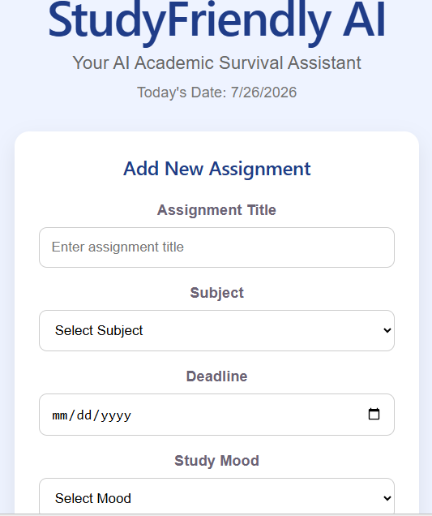
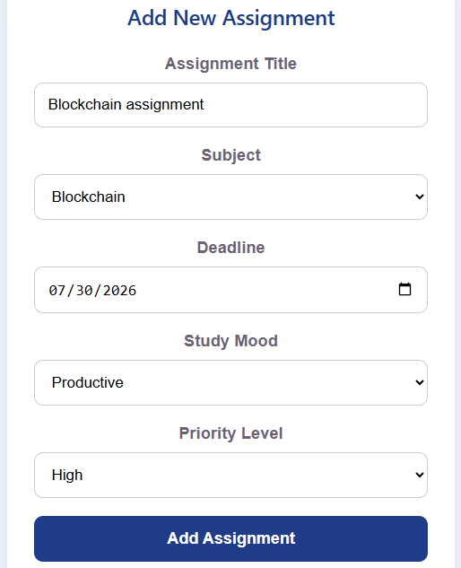
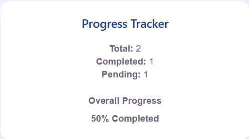
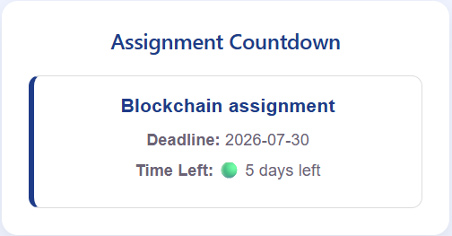
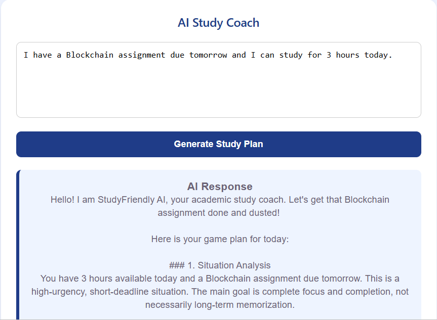

# StudyFriendly AI

## Project Overview

StudyFriendly AI is an AI-powered academic assistant designed to help students manage their assignments, track deadlines, and generate personalized study plans. It solves the common problem of poor time management and academic stress by providing smart study recommendations and assignment tracking tools.

This application is especially useful for university students who struggle to organize their coursework and prepare for deadlines effectively.

StudyFriendly AI is designed for university and college students who want to manage their assignments efficiently and improve their study habits.

---

## Real Problem Solved

Many students find it difficult to manage multiple assignments, deadlines, and study schedules. StudyFriendly AI helps students stay organized, stay productive, and reduce academic stress by combining assignment management with AI-powered study recommendations.

---

## Live Demo

- Live URL: https://studyfriendly-ai.netlify.app
- GitHub Repository: https://github.com/khadijafridi2007-source/StudyFriendly-AI

---

## Features

- Add new assignments.
- Select assignment subjects.
- Set assignment deadlines.
- Set study mood and priority levels.
- Search assignments by title or subject.
- Filter assignments by priority.
- Mark assignments as completed or pending.
- Delete individual assignments.
- Delete all assignments.
- View assignment countdown timers.
- Track academic progress using a progress bar.
- Store assignments using Local Storage.
- Generate AI-powered personalized study plans.
- Responsive and user-friendly interface.

---

## AI Feature

StudyFriendly AI uses Google's Gemini AI model as a personal academic study coach.

The AI feature allows students to:

- Generate personalized study plans.
- Receive study recommendations.
- Get time management suggestions.
- Plan their studies based on deadlines and workload.
- Stay productive and organized.

---

## AI Instructions / Custom Prompt

The AI Study Coach uses Google Gemini AI to generate personalized academic guidance. The AI is designed to:

- Help students plan their studies efficiently.
- Recommend productive study strategies.
- Provide helpful academic advice.
- Encourage better time management and organization.
- Analyze the student's study situation.
- Understand deadlines and study requirements.
- Suggest realistic study schedules.
- Recommend task priorities.
- Provide helpful and easy-to-understand study advice.
- Generate personalized study plans based on user input.

---

## Tools and Technologies Used

- React.js
- Vite
- JavaScript
- CSS
- Google Gemini AI API
- Netlify
- GitHub
- Local Storage API

---

## AI Model Used

- Google Gemini AI

---
## Screenshots

### Home Page

This screenshot shows the welcome section of StudyFriendly AI, including the app title, subtitle, today's date, and the Add New Assignment form.



---

### Assignment Management

This screenshot shows an assignment added by the user with its subject, deadline, study mood, and priority level.



---

### Progress Tracker

This screenshot displays the total assignments, completed tasks, pending tasks, and the overall progress percentage.



---

### Assignment Countdown and Filters

This screenshot demonstrates the assignment countdown timer, search functionality, and priority filter options.



---

### AI Study Coach

This screenshot shows the AI Study Coach generating a personalized study plan using Google Gemini AI based on the student's input.



---

## Installation Guide

### Clone the Repository

```bash
git clone https://github.com/khadijafridi2007-source/StudyFriendly-AI.git
```

### Install Dependencies

```bash
npm install
```

### Run the Project

```bash
npm run dev
```

### Build the Project

```bash
npm run build
```

---

## Environment Variables

Create a `.env` file in the root directory and add:

```env
VITE_GEMINI_API_KEY=YOUR_GEMINI_API_KEY
```

Replace `YOUR_GEMINI_API_KEY` with your own Google Gemini API key.

---

## How to Run the Project Locally

1. Clone the repository.
2. Install all dependencies using `npm install`.
3. Create a `.env` file.
4. Add your Gemini API key.
5. Run the application using:

```bash
npm run dev
```

6. Open the local development server in your browser.

---

## Future Improvements

- Study reminders and notifications.
- Weekly study analytics.
- Calendar integration.
- Dark mode support.
- Multi-user authentication.
- Mobile-friendly enhancements.

---

## Developer

Developed by:

**Khadija Afridi**

BS Software Engineering

Shaheed Benazir Bhutto Women University, Peshawar

---

## License

This project was developed for educational purposes as the Final Project for Week 7 – Ship Your AI App.