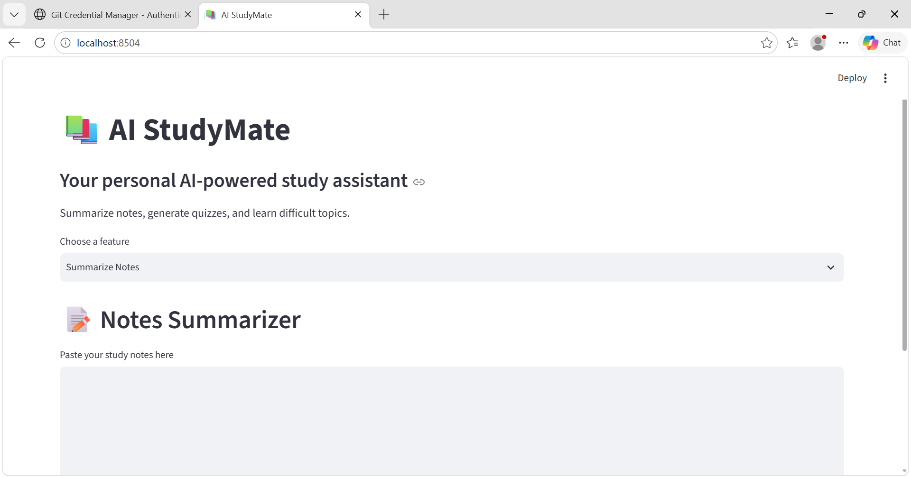

# 🎓 AI StudyMate

AI StudyMate is an AI-powered study assistant built with Python and Streamlit. It helps students summarize notes, generate quizzes, and understand difficult topics using AI.

## 📸 App Screenshot



## ✨ Features

### 📝 Notes Summarizer
- Converts lengthy notes into simple, easy-to-understand summaries.
- Helps students revise important concepts quickly.

### ❓ Quiz Generator
- Generates multiple-choice questions from notes or topics.
- Provides answers and explanations to support learning.

### 🤖 AI Tutor
- Answers students' questions.
- Explains concepts according to the selected learning level.
- Supports beginner learning, university studies, and exam revision.

## 🛠️ Technologies Used

- Python
- Streamlit
- Groq API
- Python-dotenv

## 📁 Project Structure

```text
ai-studymate/
├── main.py
├── requirements.txt
├── .gitignore
└── README.md
```

**Security:** The `.env` file contains your private API key. Never upload it to GitHub or share it publicly.

## 🚀 Setup Instructions

### 1. Clone the repository

```bash
git clone https://github.com/amnazaheer-ctrl/python-ai-engineering-journey.git
cd python-ai-engineering-journey
cd "05 Generative-AI/99-Projects/ai-studymate"
```

### 2. Install dependencies

```bash
pip install -r requirements.txt
```

### 3. Configure your API key

Create a `.env` file in the `ai-studymate` folder and add your own key:

```env
GROQ_API_KEY=your_groq_api_key_here
```

Replace the placeholder with your own Groq API key. Never share your actual key.

### 4. Run the application

```bash
python -m streamlit run main.py
```

The application will open in your browser.

## 🎯 Project Goal

This project demonstrates practical experience with Python, API integration, environment variables, and building interactive AI applications.

## 👩‍💻 Author

GitHub: [amnazaheer-ctrl](https://github.com/amnazaheer-ctrl)

---

*Built to make studying smarter and easier!*