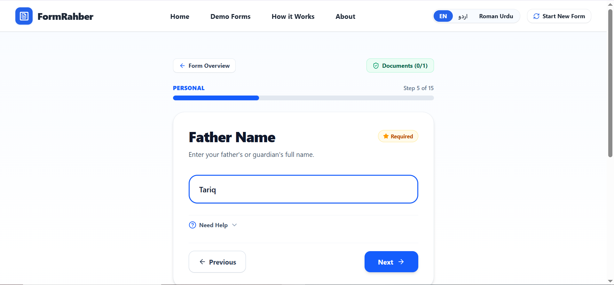
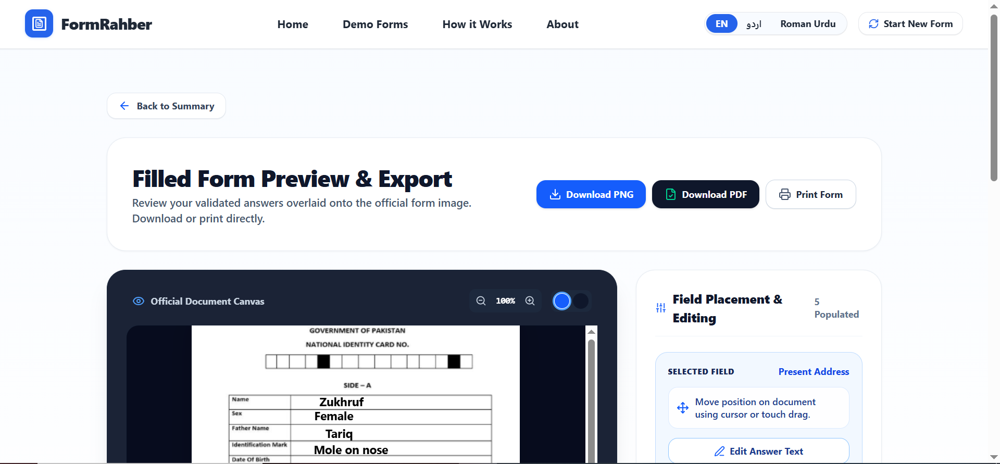

# FormRahber (فارم رہبر) 📄🤖

### AI-Powered Official Form Assistant

[](https://form-rahber.vercel.app/) [](https://react.dev/) [](https://www.typescriptlang.org/) [](https://tailwindcss.com/) [](https://ai.google.dev/)

---

## 🌍 Live Demo

**Website:** [https://form-rahber.vercel.app/](https://form-rahber.vercel.app/)

**GitHub Repository:** [https://github.com/ZukhrufMuntaha/FormRahber](https://github.com/ZukhrufMuntaha/FormRahber)

---

## 📖 Overview

FormRahber is an AI-powered web application that helps users understand and complete confusing official forms. Instead of struggling with difficult terminology and complicated instructions, users can upload a photo of a form and receive AI-generated explanations, document suggestions, and guided assistance in English, Urdu, or Roman Urdu.

The application supports common forms such as:

- 🎓 University admission forms
- 🏦 Bank account opening forms
- 🪪 CNIC / NADRA forms
- 📄 Government forms
- 💼 Job application forms
- 🎓 Scholarship forms

## ❗ Problem Statement

Many people struggle to complete official forms because they contain confusing language, unfamiliar terminology, and unclear document requirements.

This can lead to:

- Incorrect submissions
- Missing required documents
- Multiple visits to offices
- Dependence on paid form-filling agents
- Difficulties for elderly and low-literacy users

FormRahber addresses this problem using Artificial Intelligence to explain form fields in simple language and guide users through the form-filling process.

## 👥 Target Users

- Students
- Parents
- Scholarship applicants
- First-time bank customers
- Job seekers
- Citizens completing government forms
- Elderly users
- People who need help understanding official forms

## ✨ Key Features

- 📄 Upload official form images
- 🤖 AI-powered form analysis
- 🌐 English, Urdu, and Roman Urdu support
- 🔍 Automatic field detection
- 📚 Plain-language field explanations
- 📋 Smart document checklist
- 🧠 AI-guided form filling
- 🖱 Interactive drag-and-drop field placement
- 📥 Download completed forms as PDF/image
- 📱 Mobile-responsive interface
- 🎓 Sample forms for testing
- 🚫 Detection of unsupported images

## 🤖 AI Features

FormRahber uses Google's Gemini AI to analyze uploaded form images.

The AI is designed to:

- Read English and Urdu forms
- Detect visible form fields
- Explain difficult terminology
- Suggest relevant supporting documents
- Guide users while filling forms
- Identify images that are not official forms
- Generate structured JSON for use by the application

**Note:** AI-generated results may not always be accurate. Users should verify field explanations and document requirements before submitting official forms.

## 🧠 AI System Prompt

The AI is guided by instructions similar to the following:

```text
You are an AI assistant specialized in official forms.

Your responsibilities:

- Detect every visible field.
- Never invent fields.
- Read English, Urdu, and mixed-language forms.
- Explain every field in simple language.
- Suggest relevant supporting documents.
- Return valid structured JSON.
- If the uploaded image is not an official form, politely reject it.
- Never guess uncertain information.
```

This is an illustrative version of the instructions, not necessarily the complete production prompt.

## 🛠 Technologies and Models Used

### Frontend

- React 19
- TypeScript
- Tailwind CSS v4
- Vite

### Backend

- Node.js
- Express.js
- Vercel serverless functions

### Artificial Intelligence

- Google Gemini AI
- Google GenAI SDK
- Gemini vision/image-analysis capabilities

**Model name:** Confirm the exact model identifier from the application code before documenting a specific Gemini version.

### Other Libraries and APIs

- jsPDF
- Lucide React
- Motion
- Web Speech API

### Deployment and Version Control

- Vercel
- GitHub

The `server.ts` file supports local server development. In production, API functionality is provided through the `/api` directory and Vercel serverless functions, according to the project's deployment configuration.

## ⚙️ How It Works: Workflow

1. **Upload a form:** The user uploads an image of an official form.
2. **Analyze the image:** The application sends the image for AI analysis through its backend.
3. **Identify fields:** Gemini processes the image and returns structured information about the visible fields.
4. **Explain the fields:** The application presents explanations in simple language and relevant document suggestions.
5. **Fill the form:** The user follows the guided interface and enters the required information.
6. **Export the result:** The user can download the completed form using the available export functionality.

The exact output depends on the uploaded image, AI response, and features supported by the application.

## 📁 Project Folder Structure

```text
formrahber-ai/
├── api/
│   └── API endpoint files
├── assets/
│   └── Application assets
├── screenshots/
│   ├── landing.png
│   ├── upload.png
│   ├── analysis.png
│   ├── guided.png
│   └── export.png
├── src/
│   └── Frontend source code
├── .env.example
├── .gitignore
├── .gitattributes
├── bun.lock
├── index.html
├── metadata.json
├── package.json
├── README.md
├── server.ts
├── tsconfig.json
├── vercel.json
└── vite.config.ts
```

This is a high-level overview. The `api/`, `assets/`, and `src/` directories may contain additional files and subdirectories.

## 📦 Dependencies and Requirements

Before running FormRahber locally, make sure you have:

- **Node.js:** A version compatible with the project dependencies
- **npm:** For installing and managing packages
- **Google Gemini API key:** Required for Gemini API requests
- **Internet connection:** Required for API access and dependency installation
- **Git:** Optional, but useful for cloning the repository

The project's `package.json` defines its dependencies and available scripts.

Important packages include React, Vite, TypeScript, Express, the Google GenAI SDK, and other libraries used by the application.

## 🚀 Installation and Setup

### 1. Clone the repository

```bash
git clone https://github.com/ZukhrufMuntaha/FormRahber.git
```

### 2. Open the project directory

```bash
cd FormRahber
```

### 3. Install dependencies

```bash
npm install
```

### 4. Configure environment variables

Create a `.env` file in the project root, using `.env.example` as a reference.

Add your own configuration values:

```env
GEMINI_API_KEY=YOUR_GEMINI_API_KEY
APP_URL=YOUR_APP_URL
```

Replace the placeholders with the appropriate values for your local environment. Follow the project's existing configuration for any variables that are optional or supplied automatically in deployment.

**Security:** Never commit your real `.env` file, Gemini API key, or other private credentials to GitHub.

## 🔑 Required Environment Variables

| Variable | Purpose |
|---|---|
| `GEMINI_API_KEY` | Authenticates requests to the Google Gemini API. |
| `APP_URL` | Specifies the application's hosted URL for relevant links and callbacks. |

Check `.env.example` and the source code to confirm which variables are required for local development and production.

## ▶️ How to Run the Project

After installing dependencies and configuring the environment:

```bash
npm run dev
```

Open the local URL printed in the terminal by the development server.

The exact commands available for development, building, and previewing depend on the scripts defined in `package.json`.

For example, if the corresponding scripts exist, you can use:

```bash
npm run build
npm run preview
```

The Express server and Vercel API functions may have different execution requirements, so follow the project's existing configuration when testing backend functionality.

## 📸 Screenshots

### Landing Page


### Upload Form


### AI Analysis


### Guided Filling



### Export Filled Form



## 🌐 Deployment

FormRahber is deployed on Vercel.

General deployment steps:

1. Push the project to GitHub.
2. Import the repository into Vercel.
3. Configure the required environment variables in Vercel project settings.
4. Deploy the application.
5. Test the deployed website and its API endpoints.

The Gemini API key must be configured securely on the server side and must not be exposed in client-side code.

**Live URL:** [https://form-rahber.vercel.app/](https://form-rahber.vercel.app/)

## 🔒 Privacy and Security

- No permanent user database is intended for storing uploaded forms.
- The application processes images for AI-assisted analysis.
- API credentials should be stored using environment variables.
- Sensitive credentials must never be committed to GitHub.
- Users should avoid uploading unnecessary sensitive personal information.
- AI-generated guidance should be verified before official submission.

Refer to the application's actual implementation and deployment configuration for the precise handling and retention of uploaded images and API requests.

## ⚠️ Limitations

- Analysis quality can depend on image resolution, lighting, and readability.
- Complex layouts, handwritten content, or unclear text may be difficult to interpret accurately.
- AI-generated explanations and document suggestions may contain errors.
- Official requirements can vary by institution, department, and application type.
- Gemini-powered functionality depends on API availability, valid credentials, and applicable usage limits.
- Users should review completed forms before submitting them to an official organization.

## 🔮 Future Improvements

- Multi-page form support
- Voice input
- User accounts, if needed
- Optional saving of previous forms
- Support for additional languages
- Digital signatures
- Improved OCR and field detection

## 🙏 Acknowledgements

- Google Gemini AI
- React
- TypeScript
- Tailwind CSS
- Vite
- Vercel
- Lucide Icons
- jsPDF

## 📚 References

- [Google Gemini API Documentation](https://ai.google.dev/gemini-api/docs)
- [Google GenAI SDK](https://github.com/googleapis/js-genai)
- [React Documentation](https://react.dev/)
- [TypeScript Documentation](https://www.typescriptlang.org/docs/)
- [Tailwind CSS Documentation](https://tailwindcss.com/docs)
- [Vite Documentation](https://vite.dev/guide/)
- [Express.js Documentation](https://expressjs.com/)
- [Vercel Documentation](https://vercel.com/docs)

## 📄 License

This project is intended to use the MIT License. Refer to the project's `LICENSE` file for the applicable license terms.

## 👩‍💻 Author

**Zukhruf Muntaha**

- GitHub Profile: [ZukhrufMuntaha](https://github.com/ZukhrufMuntaha)
- Project Repository: [FormRahber](https://github.com/ZukhrufMuntaha/FormRahber)
- Live Demo: [form-rahber.vercel.app](https://form-rahber.vercel.app/)

Final Project — AI Application Development, 2026

Made with ❤️ using React, TypeScript, and Google Gemini AI.
